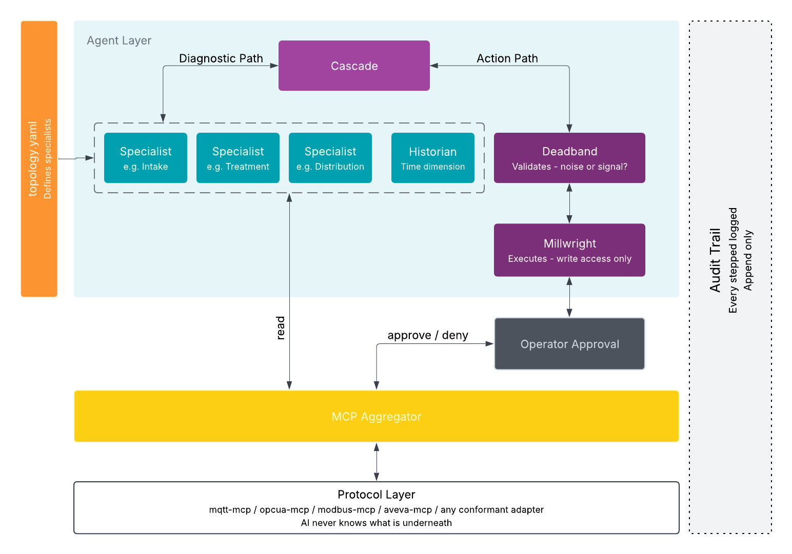

# Introduction

Industrial facilities generate continuous streams of operational data. Pumps, tanks, valves, dosing systems, UV banks. Every piece of equipment produces signals that describe its condition. The people who need to understand those signals — operators, maintenance technicians, plant managers — have always been separated from them by the tools required to access them.

For decades the answer was SCADA systems and historians. They normalized the chaos of industrial protocols, built object models from the noise and made data visible to those who knew how to read a trend screen or write a query. That was the right answer for its time. The barrier got lower. But it never went away.

The barrier today is not connectivity. The data is accessible. The barrier is fluency. You need to know which tag to query, which trend to pull, which historian to open, which dashboard to read. You need to know what normal looks like to recognize abnormal. You need to know the plant.

Fieldworks removes that barrier. Not by replacing the historians, SCADA platforms or protocol infrastructure, those already work, but by putting a natural language interface on top of them. The same way a web browser didn't replace the control system but made its value accessible to anyone with a network connection, Fieldworks makes plant intelligence accessible to anyone who can ask a question.

The interface is a chat window. The intelligence is the plant.

# What Fieldworks Is

Fieldworks is an open source, MCP-native industrial AI framework. It is protocol-first, plant-agnostic and designed to run fully on-premises in air-gapped environments.

It is not a cloud service. It is not a proprietary platform. It is not a point solution for a specific protocol or vendor. It is a framework. A set of architectural patterns, configuration schemas, agent designs and protocol contracts that any OT engineering team can deploy, extend and build on.

The framework has three layers.

**The protocol layer** is a collection of conformant MCP servers. One per industrial protocol. MQTT, OPC-UA, Modbus, DNP3, EtherNet/IP, AVEVA System Platform. Each protocol becomes a standardized tool surface. The AI never knows what protocol is underneath. Swap the adapter, nothing else changes.

**The plant layer** is driven by a single configuration file, topology.yaml, that describes the facility. Equipment types, instances, attributes, normal operating ranges, fault modes, process areas and write permissions. From this one file, the framework derives specialist agent configurations, fault detection baselines, dashboard definitions and system prompt context. Changing the config changes the plant. The framework code does not change.

The agent layer is where reasoning happens. Cascade orchestrates. Specialists diagnose. Deadband validates. Millwright executes. The Historian provides time dimension across all of it. These agents work together across the diagnostic and action paths, with every step logged to an append-only audit trail.

# What Fieldworks Is Not

Fieldworks is not a replacement for your control system. It does not manage setpoints autonomously without your knowledge. It does not make safety decisions. It does not operate independently of the people responsible for the plant.

It is a tool that makes those people more capable. It surfaces conditions they might have missed. It proposes actions for their consideration. It executes what they approve. It documents everything — the condition, the reasoning, the decision, the outcome — in a form that satisfies compliance requirements and builds operator trust over time.

The goal is not autonomous operation. The goal is accessible intelligence, with the operator always in the loop until they decide, consciously and deliberately, to widen the loop.

# Who This Specification Is For

This specification has three audiences, corresponding to three stages of engagement with Fieldworks.

**Protocol adapter builders** — SIs, equipment vendors and OT engineers who want to build a conformant MCP server for a protocol not yet supported. Part I covers the protocol layer specification. Required tools, signatures, metadata, error handling, naming conventions.

**Plant deployers** — OT engineering teams deploying Fieldworks against a real facility. Part II covers the plant layer specification. The topology config schema, process area definitions, equipment type modeling, fault mode design, write permission configuration.

**Framework contributors** — teams extending or building on the agent layer. Part III covers the agent layer specification. The fixed agent designs, specialist instantiation patterns, the action path, trust modes and the audit trail contract.

These are not separate audiences. They are stages of the same journey. The adapter builder becomes the deployer becomes the contributor. The specification is written to support that progression.

# A Note on Design Philosophy

Every decision in Fieldworks reflects a single conviction. The data is at the plant, the people who need it are sometimes elsewhere and the barrier between them is a technology problem worth solving.

The web browser solved this problem once. Not by replacing the control system but by making its value accessible to people who couldn't otherwise reach it. Fieldworks solves it again, for a different barrier, with different tools.

The chat window is not the point. Accessible plant intelligence is the point. The chat window is just the current best answer to the question of how you remove the barrier between an operator and their plant at 2am.

That answer will change. The problem will not.
